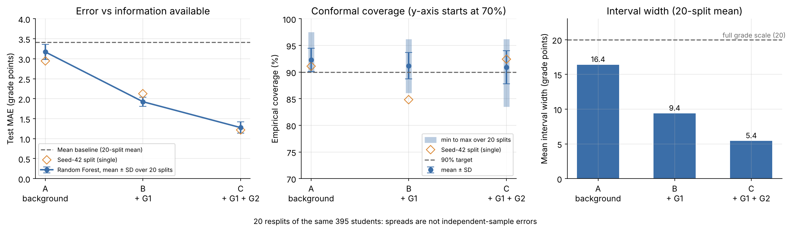
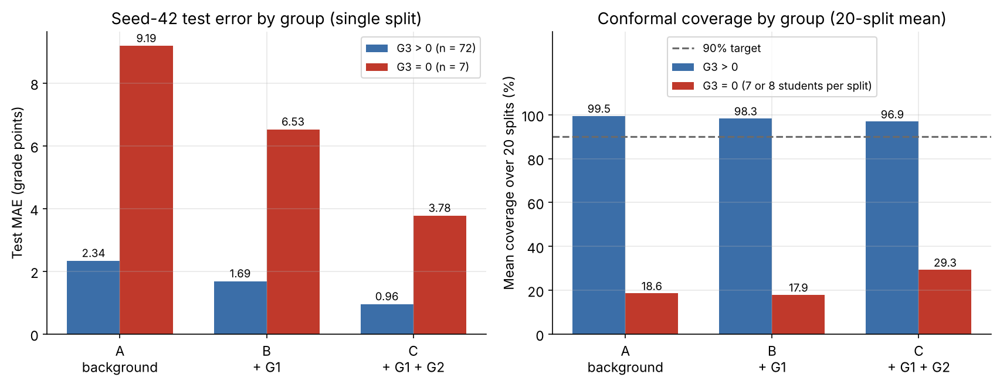
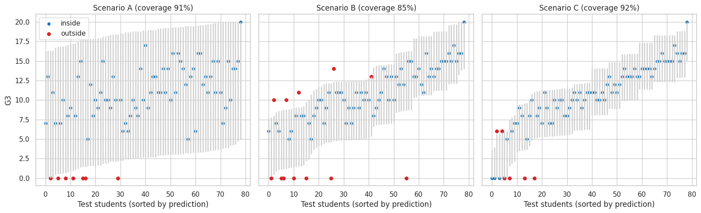
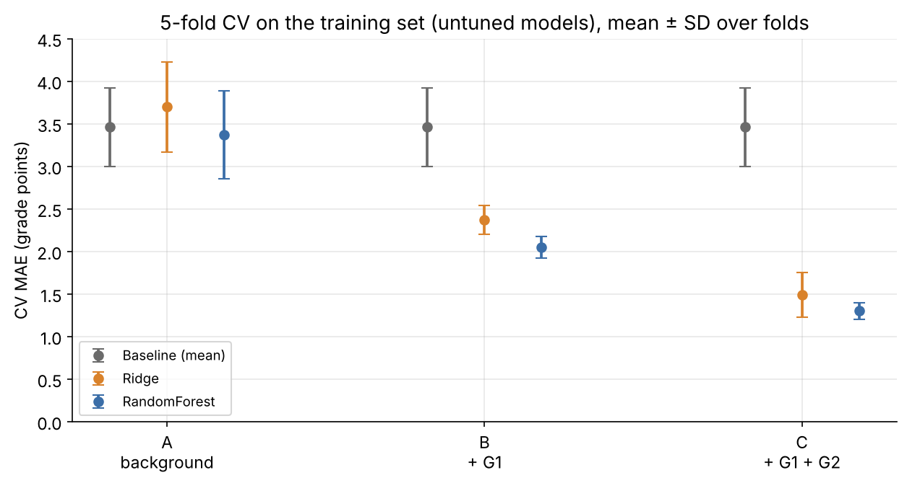
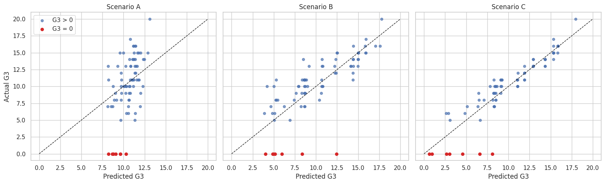
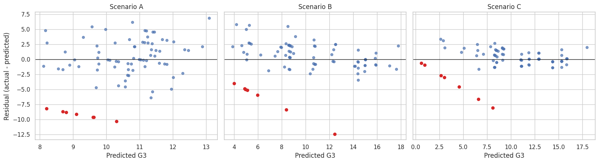
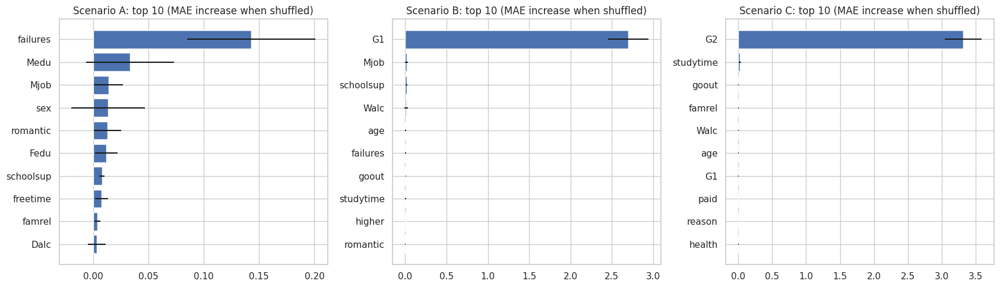

# Early Student Performance Prediction with Conformal Uncertainty Estimation

<!-- AUTO-GENERATED by scripts/build_readme.py from results/*.csv. Edit scripts/readme_template.md, not this file. -->

## Summary

- Predicts the final grade G3 (0-20) of 395 secondary-school students (UCI *Student Performance*, math course) at three points in the term: **A** background features only, **B** + first-period grade G1, **C** + G1 + G2. Random Forest, Ridge and a mean baseline are compared; 90% split-conformal prediction intervals are implemented from scratch in NumPy.
- Background features alone improve on the mean baseline only slightly: MAE 3.17 vs 3.41 (mean of 20 splits), mean R² 0.12. With G1 and G2, MAE drops to 1.93 and 1.28.
- Average interval coverage is close to the 90% target (92.3% / 91.2% / 90.9% for A / B / C over 20 splits), but scenario A intervals are 82% of the whole grade scale wide, and students with G3 = 0 (likely dropouts) are covered only 17.9-29.3% of the time.
- Everything was run on Kaggle. The result tables in this repo were **reconstructed from the printed notebook outputs** (the original CSV files were lost); see [Provenance](#provenance-of-the-numbers).
- This is a small research exercise. It is not a deployable system and must not be used to make decisions about individual students.

## Data

| | |
|---|---|
| Source | UCI Machine Learning Repository, *Student Performance* (P. Cortez), file `student-mat.csv` (math course) |
| Link / DOI | https://archive.ics.uci.edu/dataset/320/student+performance , https://doi.org/10.24432/C5TG7T |
| License | Creative Commons Attribution 4.0 (CC BY 4.0), as stated on the UCI dataset page (checked 2026-11-15) |
| Copy used | A Kaggle copy of the UCI data (not compared byte-by-byte with the UCI file). The notebook checks pass: shape, no missing values, no duplicates, all categories and ranges valid |
| Rows x columns | 395 x 33 (17 text, 16 numeric); missing values: 0; duplicate rows: 0 |
| Target G3 | mean 10.42, SD 4.58, range 0-20; 38 students (9.6%) have G3 = 0 |
| Raw data | **Not included** in this repo. Download it from the UCI link above |

**Citation.** Cortez, P. and Silva, A. (2008). *Using data mining to predict secondary school student performance.* Proceedings of the 5th FUture BUsiness TEChnology Conference (FUBUTEC 2008). Dataset: Cortez, P. (2008). Student Performance [Dataset]. UCI Machine Learning Repository. https://doi.org/10.24432/C5TG7T

Split used for the main (seed 42) results (stratified on G3 = 0):

| Set | Rows | Share % | G3 = 0 (count) | G3 = 0 (share %) | G3 mean | G3 SD |
|---|---|---|---|---|---|---|
| train | 237 | 60.0 | 23 | 9.7 | 10.50 | 4.63 |
| calib | 79 | 20.0 | 8 | 10.1 | 10.30 | 4.63 |
| test | 79 | 20.0 | 7 | 8.9 | 10.27 | 4.44 |

All 38 students with G3 = 0 have `absences` = 0, against 77 of 357 other students. Correlation of `absences` with G3 is 0.03 for all students and -0.21 without the G3 = 0 students. `absences` is therefore excluded from all scenarios (it also accumulates over the term).

## Methods

- **Scenarios.** A: 29 background features. B: A + G1. C: A + G1 + G2. Excluded everywhere: G3 (target) and `absences`.
- **Split.** 60 / 20 / 20 train / calibration / test, stratified on G3 = 0, seed 42. The test set is used only for final evaluation.
- **Preprocessing.** One-hot encoding for 17 categorical columns, standard scaling for numeric columns, inside an sklearn `Pipeline` (fitted on training data only; checked in the notebook).
- **Models.** Mean baseline, Ridge, Random Forest. 5-fold CV and a small grid search on the training set only (MAE). The model for each scenario was chosen by lowest tuned CV MAE, a rule fixed before the test set was used.
- **Split conformal prediction.** Residual score |y - prediction| on the calibration set (n = 79); q is the k-th smallest score with k = ceil((n + 1)(1 - 0.10)) = 72; interval = prediction ± q, clipped to [0, 20]. Intervals have constant width.
- **Robustness.** Bootstrap 95% CIs on the seed-42 test set (5000 resamples), and 20 stratified resplits (seeds 0-19) that reuse the hyperparameters and model choices tuned on the seed-42 training set.

## Results

Random Forest was the selected model in every scenario. MAE is in grade points (scale 0-20).

### 20 resplits (seeds 0-19): mean ± SD over splits

**Prediction error**

| Scenario | Model | Test MAE (mean ± SD) | Mean-baseline MAE | Mean improvement | Splits better than baseline | Test R² mean (min) |
|---|---|---|---|---|---|---|
| A | RandomForest | 3.17 ± 0.19 | 3.41 | 0.240 | 19 / 20 | 0.12 (min -0.07) |
| B | RandomForest | 1.93 ± 0.12 | 3.41 | 1.487 | 20 / 20 | 0.62 (min 0.52) |
| C | RandomForest | 1.28 ± 0.14 | 3.41 | 2.135 | 20 / 20 | 0.79 (min 0.68) |

**Conformal intervals (target coverage 90%)**

| Scenario | Coverage % (mean ± SD, min-max) | Coverage % G3 > 0 | Coverage % G3 = 0 | Mean width |
|---|---|---|---|---|
| A | 92.3 ± 2.2 (89.9-97.5) | 99.5 | 18.6 | 16.4 |
| B | 91.2 ± 2.5 (86.1-96.2) | 98.3 | 17.9 | 9.4 |
| C | 90.9 ± 3.1 (83.5-96.2) | 96.9 | 29.3 | 5.4 |

SD columns are over 20 overlapping splits of the same students, so they are not standard errors of independent samples. Per-split values and R² / width SDs were not saved.



### Seed-42 split (single test set, n = 79)

| Scenario | Model | Selected | MAE | RMSE | R² |
|---|---|---|---|---|---|
| A | Baseline (mean) |  | 3.361 | 4.418 | -0.003 |
| A | Ridge |  | 2.965 | 3.940 | 0.202 |
| A | RandomForest | yes | 2.950 | 3.926 | 0.208 |
| B | Baseline (mean) |  | 3.361 | 4.418 | -0.003 |
| B | Ridge |  | 1.983 | 2.731 | 0.617 |
| B | RandomForest | yes | 2.122 | 2.927 | 0.560 |
| C | Baseline (mean) |  | 3.361 | 4.418 | -0.003 |
| C | Ridge |  | 1.311 | 1.890 | 0.816 |
| C | RandomForest | yes | 1.214 | 1.806 | 0.832 |

Bootstrap 95% CIs (test-set sampling noise only):

| Scenario | Selected model | Test MAE [95% CI] | Baseline MAE | Improvement [95% CI] |
|---|---|---|---|---|
| A | RandomForest | 2.95 [2.39, 3.54] | 3.36 | 0.41 [0.19, 0.64] |
| B | RandomForest | 2.12 [1.70, 2.58] | 3.36 | 1.24 [0.64, 1.81] |
| C | RandomForest | 1.21 [0.94, 1.53] | 3.36 | 2.15 [1.59, 2.70] |

### Conformal intervals, seed-42 split

| Scenario | q | Quantile level | Coverage % all | Coverage % G3 > 0 | G3 = 0 inside | Mean width (clipped) |
|---|---|---|---|---|---|---|
| A | 8.15 | 0.911 | 91.1 (72/79) | 100.0 (72/72) | 0/7 | 16.25 |
| B | 3.79 | 0.911 | 84.8 (67/79) | 93.1 (67/72) | 0/7 | 7.54 |
| C | 2.99 | 0.911 | 92.4 (73/79) | 97.2 (70/72) | 3/7 | 5.90 |

Counts are derived from the printed coverage fractions.





### Cross-validation and tuning (training set only)

| Scenario | Model | MAE | RMSE | R² |
|---|---|---|---|---|
| A | Baseline (mean) | 3.46 ± 0.46 | 4.60 ± 0.48 | -0.01 ± 0.00 |
| A | Ridge | 3.70 ± 0.53 | 4.91 ± 0.56 | -0.15 ± 0.16 |
| A | RandomForest | 3.37 ± 0.52 | 4.48 ± 0.44 | 0.03 ± 0.12 |
| B | Baseline (mean) | 3.46 ± 0.46 | 4.60 ± 0.48 | -0.01 ± 0.00 |
| B | Ridge | 2.37 ± 0.17 | 3.14 ± 0.23 | 0.51 ± 0.12 |
| B | RandomForest | 2.05 ± 0.13 | 2.81 ± 0.18 | 0.61 ± 0.08 |
| C | Baseline (mean) | 3.46 ± 0.46 | 4.60 ± 0.48 | -0.01 ± 0.00 |
| C | Ridge | 1.49 ± 0.26 | 2.17 ± 0.37 | 0.76 ± 0.08 |
| C | RandomForest | 1.30 ± 0.10 | 2.03 ± 0.22 | 0.79 ± 0.07 |

Mean ± SD over 5 folds of the training set (default settings).



| Scenario | Model | Default CV MAE | Tuned CV MAE | Best parameters |
|---|---|---|---|---|
| A | Ridge | 3.704 | 3.292 | `{"alpha": 300}` |
| A | RandomForest | 3.370 | 3.252 | `{"max_depth": null, "max_features": 0.3, "min_samples_leaf": 10}` |
| B | Ridge | 2.373 | 2.118 | `{"alpha": 30}` |
| B | RandomForest | 2.051 | 1.993 | `{"max_depth": 3, "max_features": 1.0, "min_samples_leaf": 1}` |
| C | Ridge | 1.495 | 1.411 | `{"alpha": 30}` |
| C | RandomForest | 1.298 | 1.265 | `{"max_depth": 3, "max_features": 1.0, "min_samples_leaf": 1}` |

Tuned scores are the best of many settings and therefore optimistic. Several best values sit on the edge of the grid; the grid was not extended.

### Analysis (seed-42 test set)

Zero-grade students dominate the error:

| Scenario | MAE all | MAE G3 > 0 | MAE G3 = 0 | Share of total absolute error from G3 = 0 |
|---|---|---|---|---|
| A | 2.95 | 2.34 (n = 72) | 9.19 (n = 7) | about 28% |
| B | 2.12 | 1.69 (n = 72) | 6.53 (n = 7) | about 27% |
| C | 1.21 | 0.96 (n = 72) | 3.78 (n = 7) | about 28% |

The share is derived from the printed (rounded) MAEs.

Largest permutation importances (MAE increase when the feature is shuffled, calibration set, top 5 only):

| Rank | A | B | C |
|---|---|---|---|
| 1 | `failures` (0.143) | `G1` (2.698) | `G2` (3.316) |
| 2 | `Medu` (0.033) | `Mjob` (0.017) | `studytime` (0.025) |
| 3 | `Mjob` (0.014) | `schoolsup` (0.015) | `goout` (0.004) |
| 4 | `sex` (0.013) | `Walc` (0.013) | `famrel` (0.003) |
| 5 | `romantic` (0.013) | `age` (0.004) | `Walc` (0.003) |





EDA figures: [G3 distribution](figures/g3_distribution.png), [correlation matrix](figures/correlation_matrix.png), [boxplots](figures/boxplots_g3.png).

## Honest reading of the results

1. **RQ1, background only (A).** Over 20 splits the improvement over the mean baseline is small: 0.24 grade points on average (MAE 3.17 vs 3.41, mean R² 0.12, lowest R² -0.07). It was positive in 19 of 20 splits. The seed-42 split looked better (improvement 0.41, 95% CI [0.19, 0.64], R² 0.21), so it was a favourable split. Permutation importance shows only `failures` clearly (0.14); the next feature is `Medu` (0.03), and the rest are at noise level for n = 79.
2. **RQ2, information over time.** Mean MAE falls from 3.17 (A) to 1.93 (B) to 1.28 (C); mean R² rises from 0.12 to 0.62 to 0.79. The model relies almost entirely on the latest grade (permutation importance: G1 +2.70 in B, G2 +3.32 in C). C is the least useful for early warning because G2 is only known late in the term.
3. **RQ3, conformal coverage.** Average coverage over 20 splits is 92.3% / 91.2% / 90.9% (SD 2.2 / 2.5 / 3.1 points; lowest single split 83.5%). Marginal coverage is therefore near nominal, but it is **not conditional**: students with G3 > 0 are covered 96.9-99.5% of the time, students with G3 = 0 only 17.9-29.3% (7 or 8 students per split, by construction of the stratified split). On the seed-42 test set, 0 of 7 / 0 of 7 / 3 of 7 of the G3 = 0 students were inside their interval in A / B / C.
4. **Interval usefulness.** Mean interval width is 16.4 / 9.4 / 5.4 grade points (82% of the scale in A). A's intervals carry almost no practical information, so its near-90% coverage should not be read as a success.
5. **What inflates q.** On the seed-42 calibration set, the largest errors are mostly G3 = 0 students (8 / 8 / 6 of the 8 largest errors in A / B / C). Computing q without them would give 5.46 / 2.91 / 2.07 instead of 8.15 / 3.79 / 2.99. This is a diagnostic only (it is unknown in advance who will get G3 = 0). Even without those students, A's half-width (5.46) would still be large, so weak predictive signal also contributes.
6. **Seed-42 coverage for B** (84.8%) is lower than the lowest of the 20 resplits (86.1%), another sign that the seed-42 split was not typical. I did not test this further.
7. **Model choice.** In B, Ridge had a lower seed-42 test MAE than the selected Random Forest (1.98 vs 2.12). The selection rule was fixed beforehand, so Random Forest was kept. I did not test whether that difference is meaningful.

## Limitations

- One course, two Portuguese schools, 395 students; the test set has 79 rows and only 7 G3 = 0 students. Results may not transfer to other schools or countries.
- The "early" framing assumes the survey variables (e.g. alcohol use, going out, extra paid classes) are known at the start of the term. The files do not show when they were collected, so this is an assumption I could not verify.
- Design decisions (keep G3 = 0 students, drop `absences`) were made after EDA on all 395 rows, including rows that later became calibration and test rows.
- The 20 resplits reuse the same students, and hyperparameters / model choices were set on the seed-42 training set (rows that appear in other splits' test sets), so they are slightly optimistic and not independent.
- Conformal guarantees are marginal and assume exchangeability; the intervals here are constant-width, not adaptive, and the calibration set is small (n = 79). The "approx. SE" printed in the notebook (CELL 42) reflects test-set size only and understates the real uncertainty.
- Bootstrap intervals capture test-sampling noise only.
- Feature importance describes the model, not causal effects. The Kaggle copy of the data was not compared with the UCI file.
- Only the math course was analysed (`student-por.csv` was not used).

## Provenance of the numbers

- The notebook was run on Kaggle in several sessions; saved outputs come from different sessions and were not produced by one top-to-bottom run (execution counts are not monotonic).
- The original `results/*.csv` and checkpoint files were lost. `scripts/extract_from_notebook.py` rebuilds the tables in `results/` by parsing text printed in the saved notebook outputs, so values keep the printed precision (2-3 decimals) and nothing is recomputed. Every result table and result number in this README is generated by `scripts/build_readme.py` from those files (design facts such as seed, split sizes and package versions are taken from the notebook code and logs).
- Not recoverable: per-student predictions and intervals, per-split results of the 20 resplits (only their summary survives), and the model files.
- Figures `conformal_intervals_seed42`, `actual_vs_predicted_seed42`, `residuals_seed42`, `permutation_importance_seed42` and the three EDA figures are the images embedded in the notebook outputs. The `fig_*` figures are built by `scripts/make_figures.py` from `results/`.
- History: an early version of `conformal_q` picked the 73rd instead of the 72nd smallest calibration error. It was fixed from the formula; all conformal numbers here come from the fixed code.

## How to reproduce

**1. Rebuild tables, figures and this README from the saved results (no raw data needed):**

```bash
pip install -r requirements.txt
python scripts/extract_from_notebook.py   # notebook outputs -> results/*.csv and notebook figures
python scripts/make_figures.py            # results/ -> figures/fig_*.png
python scripts/build_readme.py            # results/ -> README.md
```

**2. Re-run the experiment.** Download `student-mat.csv` from the UCI link, then either (a) upload the notebook to Kaggle, add the dataset and run all cells, or (b) run locally after editing `/kaggle/input` and `/kaggle/working` in notebook cells 03 and 04. Use the pinned versions in `requirements.txt` (the notebook was run with pandas 2.3.3 and scikit-learn 1.6.1). Compare the printed numbers with `results/`.

Tested by me: the three scripts run on the real result files (with pandas 3.0.6, numpy 2.5.4, matplotlib 3.11.2, not the pinned versions) and the figures were inspected; all 51 notebook code cells ran without errors on **synthetic data** with the same columns (pandas 3.0.6, scikit-learn 1.9.1, forests reduced to 30 trees for speed). **Not tested by me:** a fresh end-to-end run on the real data, in the pinned environment, reproducing the numbers in `results/`.

## Repo layout

```
notebooks/early_student_performance_conformal.ipynb   cleaned notebook (51 code cells, saved outputs)
scripts/extract_from_notebook.py                      notebook outputs -> results/ and notebook figures
scripts/make_figures.py                               results/ -> figures/fig_*.png
scripts/build_readme.py, readme_template.md           results/ -> README.md
results/                                              CSV tables (reconstructed, see Provenance)
figures/                                              PNG figures
docs/REVIEW_NOTES.md                                  cell map and issues found during cleaning
requirements.txt, LICENSE, .gitignore
```

## Licenses

- Code: MIT (see `LICENSE`).
- Data: CC BY 4.0, Cortez (2008), UCI Machine Learning Repository. The raw data is not redistributed here. Result tables and figures are aggregate statistics derived from it; please keep the attribution above.
